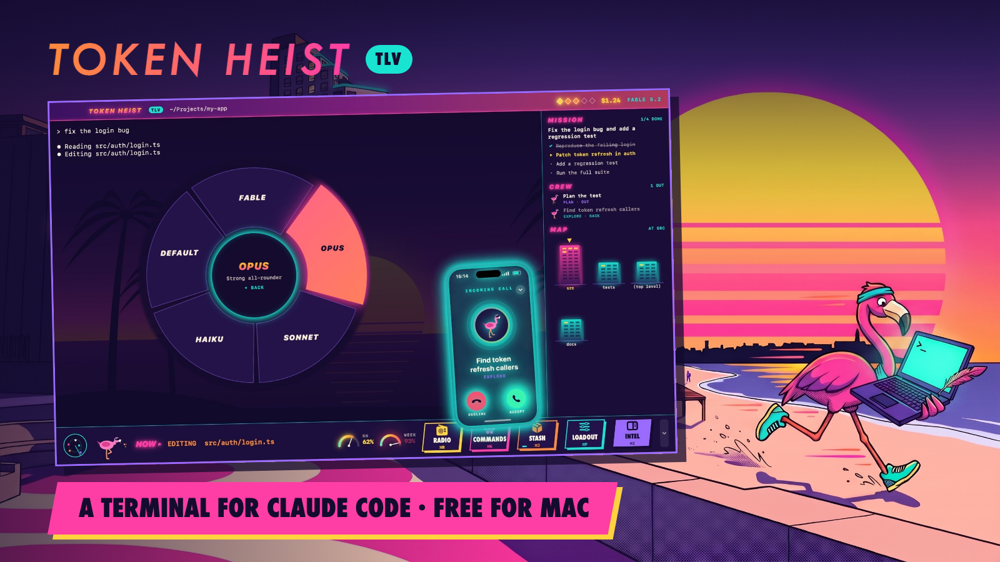
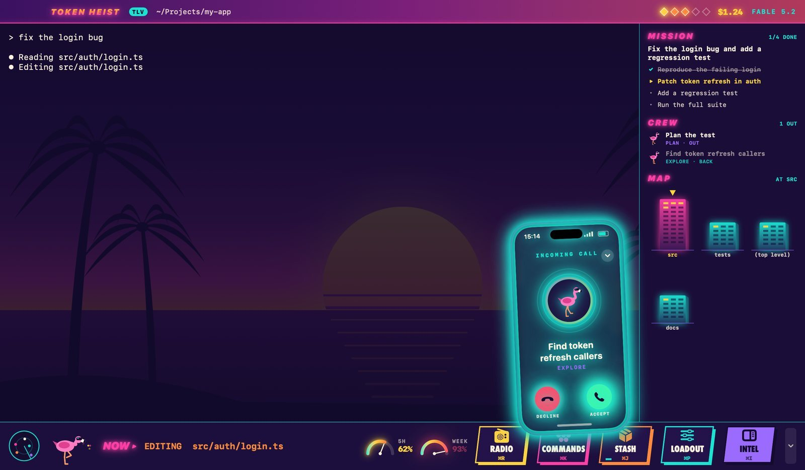
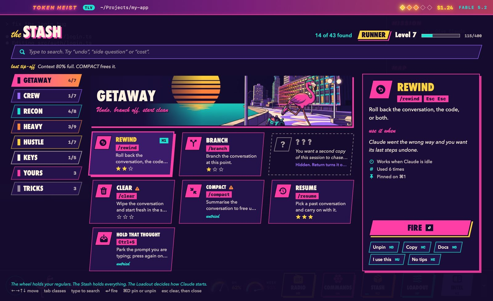
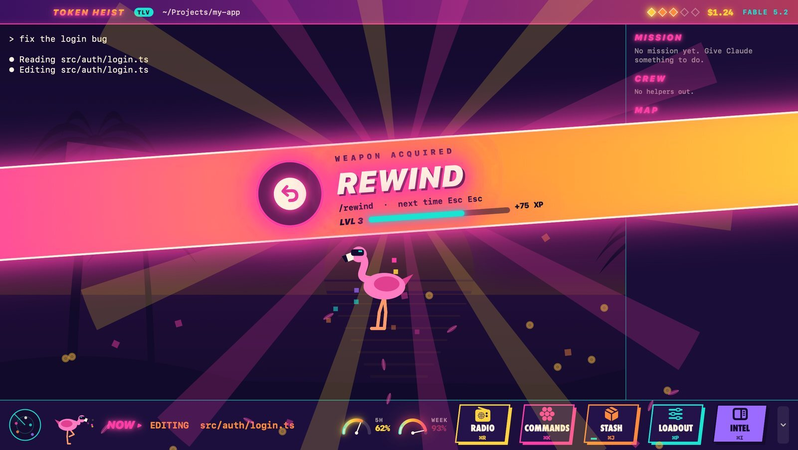
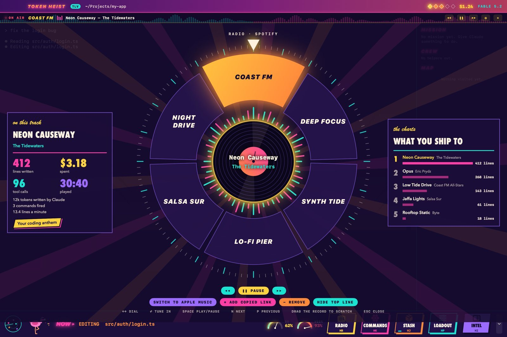
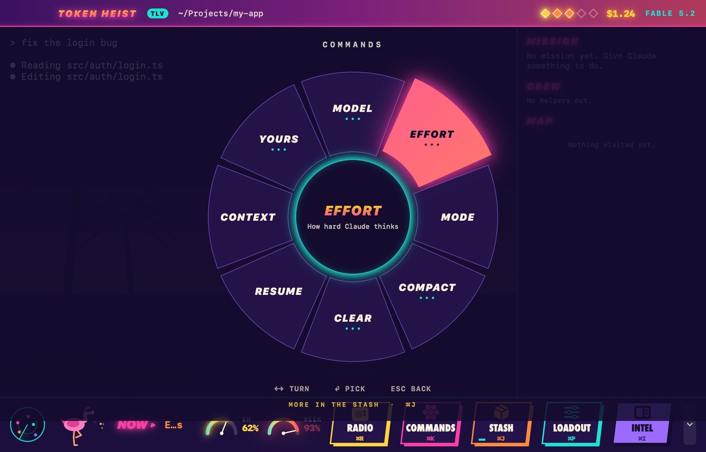
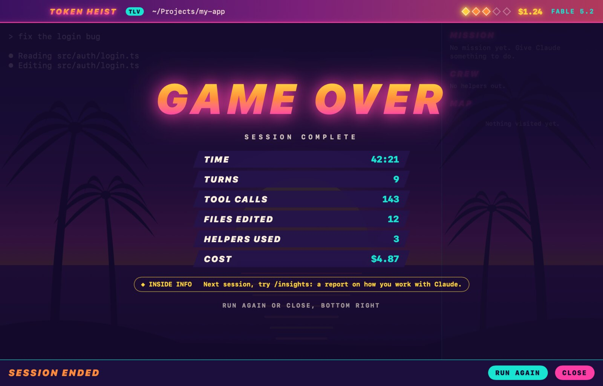

# Token Heist

A Mac terminal for Claude Code with a game-style HUD.

**[Download TokenHeist-1.0.0.dmg](https://github.com/pionion-ai/token-heist/releases/download/v1.0.0/TokenHeist-1.0.0.dmg)** · [Project page](https://pionion-ai.github.io/token-heist/)

| | |
|---|---|
|  |  |
|  |  |
|  |  |

Free. macOS 14 or later, Apple silicon and Intel. Signed and notarised by Apple.
You need [Claude Code](https://claude.com/claude-code) installed and signed in.

What the app does and does not do with your data is in [PRIVACY.md](PRIVACY.md).

All artwork, characters and lettering are original. Not affiliated with or
endorsed by Anthropic, Spotify, Apple or any game publisher. "Claude" and
"Claude Code" are trademarks of Anthropic.

This repository holds the project page and the releases. Found a bug? Open an issue here.
